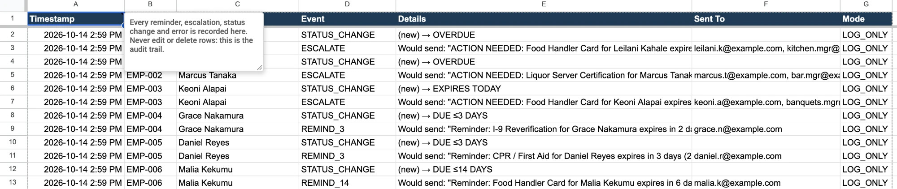
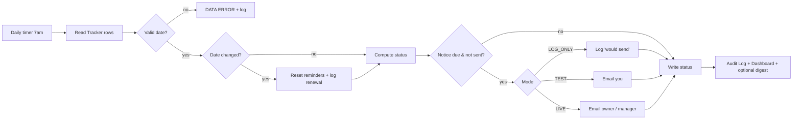

# Compliance & Expiration Tracker

**A Google Sheet that warns people before their certifications, permits and vendor insurance expire, escalates lapses to managers, and keeps an audit trail. Built with Google Apps Script.**

Made for hotels and restaurants, where food-handler cards, liquor-server certifications, CPR cards, I-9 reverification dates, vendor certificates of insurance and property permits all expire on different days and are usually tracked by memory.

## ▶ Try it yourself (1 minute, no setup)

[](https://docs.google.com/spreadsheets/d/1eqmTiSv_Z3JL1mqJYDSq0thiGa12MsO5jR1klJnoUdo/copy)
&nbsp;
[](https://docs.google.com/spreadsheets/d/1eqmTiSv_Z3JL1mqJYDSq0thiGa12MsO5jR1klJnoUdo/edit?usp=sharing)

1. Click **Make a copy**. You get your own copy with the code already inside; the original is never touched.
2. In your copy, choose **Compliance Tracker → Reset demo data**. This refreshes the sample dates around today. The first time, Google asks you to approve the script; see [step 5 below](#set-it-up-about-10-minutes) for what the "unverified app" screen means.
3. Look around: **Dashboard**, the color-coded **Tracker**, and the **Audit Log** of what *would* be emailed. Nothing is sent in the default LOG_ONLY mode.
4. To see real emails, set **Settings → Mode** to `TEST` and choose **Run check now**. Every email goes only to you.

*The menu takes a few seconds to appear after the sheet loads. All names and emails in the demo are fake.*

| | |
|---|---|
| **Daily automatic check** | Every morning it updates every item's status and sends whatever is due. |
| **Reminders that don't nag** | Owner gets one notice at 30, 14 and 3 days out (adjustable). Never the same one twice. |
| **Escalation** | On the expiry day, owner **and** manager are notified; repeats weekly while overdue. |
| **Handles bad data** | Impossible dates and missing emails are flagged, rerouted or logged. One bad row never stops the run. |
| **Renewals** | "Mark renewed" button, or just change the date; reminders reset automatically. |
| **Audit log** | Every reminder, escalation, status change, renewal and error, timestamped. |
| **Dashboard** | % compliant, overdue, due this week and month, breakdown by document, action lists. |
| **Safe to try** | Preview mode sends nothing; test mode sends everything only to you. |
| **Tested** | 22 automated tests + a 17-step manual test plan. |

### Dashboard


### Tracker: color-coded status, renewals reset automatically


### Escalation email (TEST mode: sent only to the tester, real recipients shown in the subject)


### Audit log: every status change, reminder and escalation, timestamped


📄 [Requirements](docs/requirements.md) · [Runbook](docs/runbook.md) · [Test plan](docs/test-plan.md) · [Tool manifest](docs/tool-manifest.md) · [Safety & data](docs/safety.md) · [Case study](docs/case-study.md)

---

## Set it up (about 10 minutes)

*Prefer to install from the code instead of copying the demo sheet? Follow these steps.*

1. **Make a blank Google Sheet.** Go to [sheets.new](https://sheets.new) and name it *Compliance Tracker (Demo)*.
2. **Open the script editor:** **Extensions → Apps Script**.
3. **Add the three code files.** In the editor:
   - Rename the default `Code.gs` to `Main` and replace its contents with [`apps-script/Main.gs`](apps-script/Main.gs).
   - Click **+ → Script**, name it `Logic`, paste [`apps-script/Logic.gs`](apps-script/Logic.gs).
   - Click **+ → Script**, name it `Setup`, paste [`apps-script/Setup.gs`](apps-script/Setup.gs).
   - Click 💾 **Save**.
4. **(Optional, recommended) Limit permissions.** In **Project Settings ⚙**, tick **Show "appsscript.json" manifest file in editor**. Back in the editor, replace that file's contents with [`apps-script/appsscript.json`](apps-script/appsscript.json) and save. The script can then only touch this one spreadsheet.
5. **Run setup.** Click **Setup.gs**, then in the toolbar's function dropdown **change it from `onOpen` to `setupTracker`** (the dropdown defaults to the first function in the file) and click **▶ Run**. Switch to the spreadsheet tab right away: a "Tracker ready" pop-up waits there for you to click OK.
   - Google asks for permission. Because this is your own script and not a published app, you'll see *"Google hasn't verified this app."* Click **Advanced → Go to (project name) (unsafe) → Allow**. That warning appears for every personal Apps Script project.
6. **Go back to the spreadsheet** and click OK on the pop-up. **Reload the tab**, and a **Compliance Tracker** menu appears.
7. Nothing has been emailed yet (Mode is `LOG_ONLY`). Open **Audit Log** to see what *would* have been sent.

### Try the emails safely
**Settings → Mode → `TEST`**, then **Compliance Tracker → Run check now**. Every email goes to **you**, with the real recipient shown in the subject. Run it again and nothing new is sent, because reminders never repeat.

### Turn on the daily check
**Compliance Tracker → Turn on daily check.** Runs around 7 am (change **Settings → Daily run hour**). **Turn off daily check** stops it.

---

## How it decides what to send

```
days until expiry   status            notice
      > 30          OK                —
     15–30          DUE ≤30 DAYS      Reminder to owner (once)
      4–14          DUE ≤14 DAYS      Reminder to owner (once)
      1–3           DUE ≤3 DAYS       Reminder to owner (once)
        0           EXPIRES TODAY     ESCALATION to owner + manager (once)
       < 0          OVERDUE           Repeat to owner + manager every 7 days
   bad/missing      DATA ERROR        Nothing sent; flagged + logged
```
An item added late only gets the most urgent notice that applies, so someone with 5 days left gets the 14-day reminder, not three emails at once.



## Project layout
```
apps-script/   Logic.gs (rules, unit-tested) · Setup.gs (sheet + dashboard) · Main.gs (daily check, email, log) · appsscript.json
tests/         logic.test.js · check.test.js   →  npm test
docs/          requirements · runbook · test plan · tool manifest · safety · case study
```

## Run the tests
Needs Node 18+:
```bash
npm test
```
