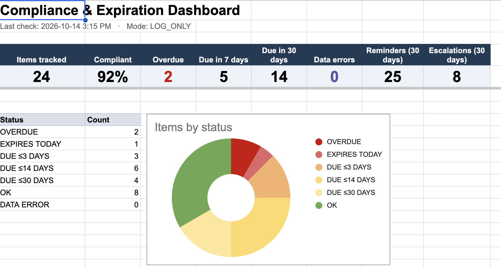
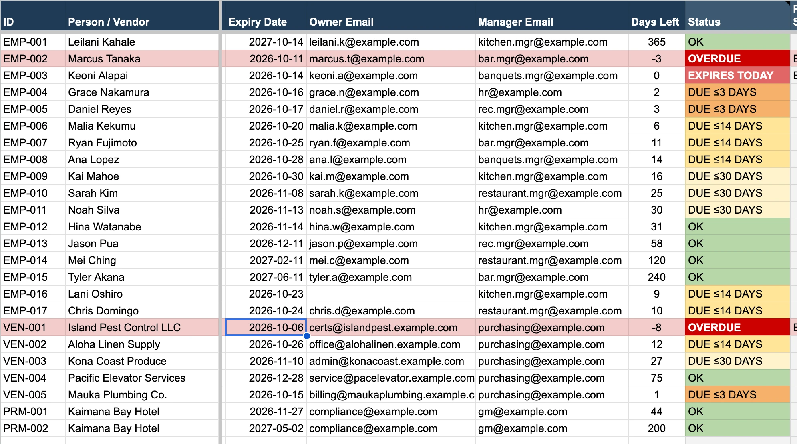
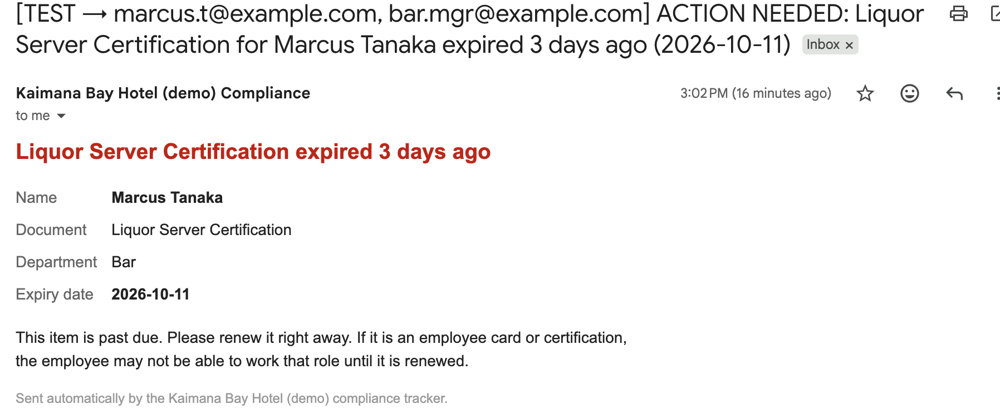

# Case study draft: "Nothing Expires"

> **Turns a ~95-minute weekly compliance chore into an automatic 7 am check, so no certification, permit or vendor insurance lapses unnoticed.**
>
> *Fill in the [brackets] after your own test run. Keep "estimate" wherever the number isn't measured.*

**The problem.** In ten years of restaurant and hotel operations, I've seen the same thing happen again and again. A food-handler card or liquor-server certification expires and nobody notices until a manager is pulling someone off a shift or an inspector asks for it. Vendor insurance lapses the same way. The tracking usually lives in one person's spreadsheet or memory.

**Who it's for.** HR and compliance coordinators, department managers, and the GM who has to answer for it at an inspection or audit.

**What I built.** A Google Sheet with an Apps Script automation that:
- checks every item each morning and color-codes its status;
- emails the owner 30, 14 and 3 days before expiry, never the same reminder twice;
- escalates to the manager on the expiry day and weekly after that;
- flags bad data (impossible dates, missing emails) instead of breaking;
- logs every reminder, escalation, renewal and error to an audit trail;
- shows a live dashboard: % compliant, overdue, due this week and month.

**How I made sure it works.**
- **22 automated tests**, including a simulated 75-day timeline proving the exact reminder sequence, and tests for every failure case (bad dates, missing emails, quota limits, renewals, duplicate runs).
- A **17-step manual test plan** run in a live Google Sheet. Live testing caught **4 issues the automated tests couldn't** (garbled symbols after copy-paste, chart colors ignored, a dashboard count that included preview runs, and a confusing setup step). All four were fixed and documented in the [test plan](test-plan.md).
- **Safe rollout:** a preview mode that sends nothing and a test mode that sends everything only to me, before anything reaches a real person.

**Results** *(estimates for a ~100-employee property with ~150 tracked items)*
- Manual tracking: ~45 min/week of spreadsheet review + ~10 reminder emails × 5 min ≈ **95 min/week (~80 hrs/year)**.
- With the tracker: ~10 min/week reviewing the digest and recording renewals. **Saves ~85 min/week (estimate).**
- In my test run: **24 items checked in one run: 4 expired or expiring-today items escalated to managers, 12 owner reminders across the 30/14/3-day stages, 1 impossible date caught and flagged instead of crashing**, plus a missing owner email automatically rerouted to the manager.
- Bigger win: lapses surface 30 days early instead of on the day of an inspection.

**What I'd do next.**
- A Google Form so employees can upload their renewed card and update the tracker themselves.
- A Microsoft Power Automate version for companies on Microsoft 365.
- Use AI to read the expiry date straight off an uploaded certificate (that's Project 2).

**Tools:** Google Sheets · Google Apps Script (JavaScript) · Gmail · Node.js test runner

[Try it: make a copy](https://docs.google.com/spreadsheets/d/1eqmTiSv_Z3JL1mqJYDSq0thiGa12MsO5jR1klJnoUdo/copy) · [Code on GitHub](https://github.com/NormStormm/compliance-tracker) · [Runbook](runbook.md) · [Test plan](test-plan.md) · [Video, 90 sec: coming]

---

## 90-second video outline
1. **(0–15s) The problem.** Show the Tracker: "Here's ~25 certifications and permits for a hotel. Three are already expired and nobody's been told."
2. **(15–35s) Run the check.** Menu → Run check now. Show the toast, then the colored statuses.
3. **(35–50s) The emails.** Open the TEST-mode inbox: a reminder and a red ACTION NEEDED escalation.
4. **(50–65s) It handles mess.** Show the purple DATA ERROR row and the Audit Log line explaining it; show the manager fallback for a missing email.
5. **(65–80s) Renewal.** Mark renewed → status turns green → RENEWED in the log.
6. **(80–90s) Dashboard + numbers.** "% compliant, overdue list. Saves about 85 minutes a week (estimate). 22 automated tests."
